# Multi-Site Enterprise Network — Summit Sporting Goods

*OSPF · IPSec site-to-site VPN · VLANs & 802.1Q · Rapid-PVST · ACLs · DHCP · Port Security · Syslog & NTP*

Hi — this is a two-site enterprise network built and validated from scratch for a
ten-person retailer opening a second location. The main office and the new
warehouse/storefront exchange order, inventory, and customer data continuously over
the public internet, so the network has to route between sites automatically,
encrypt everything in transit, keep the public guest Wi-Fi isolated from internal
business systems, and survive a single cable failure at the warehouse.

Ten test cases were defined up front and each one was run and evidenced against the
built network. Every test case below includes the screenshots that prove it — expand
the **Evidence** section under each one.

---

## Table of Contents

1. [The Business Requirement](#the-business-requirement)
2. [Environment](#environment)
3. [Addressing & Segmentation](#addressing--segmentation)
4. [Architecture](#architecture)
5. [Core Concepts](#core-concepts)
6. [Test Coverage](#test-coverage)
7. [Segmentation and Access Control](#segmentation-and-access-control)
8. [Addressing Services](#addressing-services)
9. [Layer 2 Redundancy](#layer-2-redundancy)
10. [Inter-Site Connectivity](#inter-site-connectivity)
11. [Security and Monitoring](#security-and-monitoring)
12. [Problems Resolved](#problems-resolved)
13. [Lessons Learned](#lessons-learned)
14. [Tools & Technologies](#tools--technologies)
15. [Project Status](#project-status)

---

## The Business Requirement

Summit Sporting Goods is a small sporting goods and apparel retailer with ten
employees, selling through an e-commerce site and a physical office. To support
growth it is opening a second location combining a fulfillment warehouse with a
customer-facing storefront. The main office holds the marketing and IT teams; the
warehouse handles inventory, fulfillment, and shipping; the storefront lets customers
buy in person and collect orders.

The two sites exchange order data, inventory, and customer records continuously.
Because that traffic includes customer personal data and crosses the public
internet, it has to be encrypted in transit. The storefront also offers guest Wi-Fi,
which must never reach internal business systems.

That produces five design requirements:

1. Route between both sites automatically, without static routes to maintain
2. Encrypt all inter-site traffic across the internet
3. Segment the business by function at Layer 2, and enforce who can reach what
4. Isolate the guest network to internet access only
5. Survive a single link or port failure at the warehouse

---

## Environment

| Component | Detail |
| --- | --- |
| Virtual lab | Cisco Packet Tracer |
| Site 1 — Main Office | R1 (edge router), Core-MLS (multilayer switch), SRV1, PC-Admin, PC-Marketing, PC-Customer Service |
| Site 2 — Warehouse / Storefront | R2 (edge router), SW1, SW2, PC-Ops1, PC-Ops2, Tablet-Guest, AP_Summit_Guest |
| Transit | ISP router carrying traffic between the two public endpoints |
| External | SaaS host at 209.165.200.226 — the internet destination guests can reach |
| Test device | Laptop-Rogue — unauthorized device used for the port security test |
| Routing | OSPF across R1, ISP, R2, and Core-MLS |
| Encryption | Site-to-site IPSec VPN, R1 ↔ R2 |

---

## Addressing & Segmentation

| VLAN | Name | Subnet | Location | Hosts |
| --- | --- | --- | --- | --- |
| 10 | Admin | 10.10.10.0/24 | Main Office | SRV1 (static, 10.10.10.10), PC-Admin |
| 20 | Staff | 10.10.20.0/24 | Main Office | PC-Marketing, PC-Customer Service |
| 30 | Guest | 10.20.30.0/24 | Storefront | Tablet-Guest via AP_Summit_Guest |
| 40 | Warehouse-Ops | 10.20.40.0/24 | Warehouse | PC-Ops1, PC-Ops2 |

**Access policy**

| From ↓ / To → | SRV1 (VLAN 10) | Warehouse-Ops (VLAN 40) | Internet |
| --- | --- | --- | --- |
| Admin (VLAN 10) | ✅ | ✅ | ✅ |
| Staff (VLAN 20) | ✅ | ❌ | ✅ |
| Guest (VLAN 30) | ❌ | ❌ | ✅ |

Two ACLs enforce this: **STAFF-RESTRICT** on Core-MLS and **GUEST** on R2.

---

## Architecture

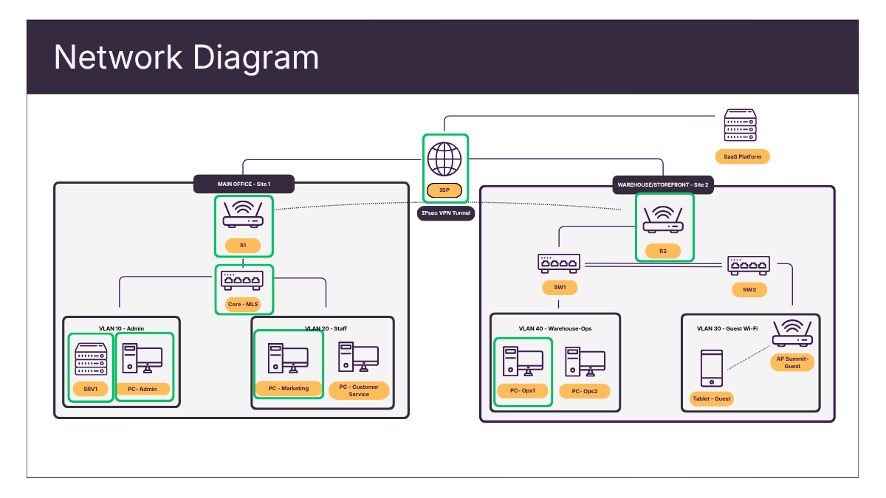

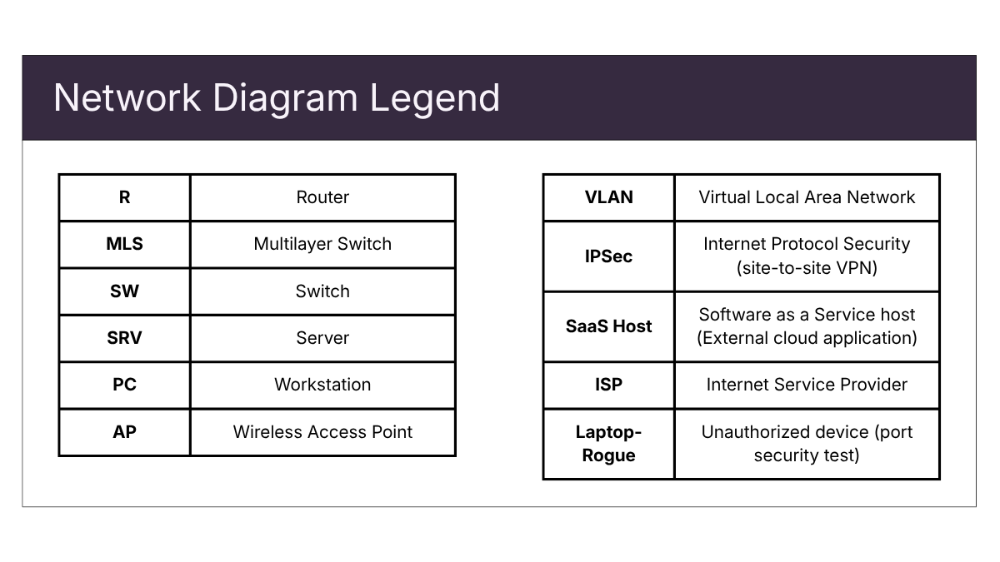

The main office (Site 1) connects through R1 and Core-MLS, which routes between the
Admin and Staff VLANs. The warehouse/storefront (Site 2) connects through R2 to two
switches joined by redundant links: SW1 serves Warehouse-Ops and SW2 serves the guest
access point. R1 and R2 reach each other across the ISP through an IPSec tunnel.

---

## Core Concepts

A short primer on the mechanisms behind the test cases.

### OSPF adjacency and route learning

Routers running OSPF discover each other, exchange link-state information, and each
build their own map of the network. The adjacency progresses through states, and
`FULL` means the two routers have synchronized databases and can exchange routes.
Learned routes appear in the routing table with an `O` code, distinguishing them
from connected (`C`) and static (`S`) routes.

The practical benefit here: neither site needs a static route to the other. Add a
subnet at the warehouse and the main office learns it automatically.

### IPSec is triggered, not permanently up

A site-to-site IPSec tunnel is not a cable. It comes up only when traffic matches
the crypto access list, which is why a fresh tunnel shows empty tables:

```
1. Interesting traffic hits the router      → matches crypto ACL 110
2. ISAKMP (Phase 1) negotiates              → pre-shared key authentication
3. IPSec (Phase 2) builds the SAs           → QM_IDLE / ACTIVE
4. Packets are encrypted and encapsulated   → encrypt/decrypt counters climb
```

The first few pings often time out while Phase 1 and 2 complete, then replies
succeed. That is expected behavior, not a fault.

Traffic *not* matching the crypto ACL never enters the tunnel — which is how guest
traffic is excluded: by omission from ACL 110, not by an explicit deny.

### Spanning Tree root bridge election

Two links between SW1 and SW2 give the warehouse redundancy, but also a physical
loop. Rapid-PVST (802.1w) blocks one path while keeping it on standby.

The switch with the lowest bridge priority becomes root. Priority is configured in
increments of 4096, and the switch adds the VLAN ID to the configured value — so
priority 4096 on VLAN 40 displays as **4136**, and 8192 displays as **8232**. That
arithmetic surprises people reading the output for the first time.

Because the root keeps all of its ports forwarding, the blocking decision happens on
the non-root switch: SW2 selects one link as its root port (FWD) and puts the other
into the alternate role (BLK).

### Port security violation modes

Sticky MAC learning records the first MAC address seen on a port and writes it into
the running configuration. With a maximum of one address and a `shutdown` violation
action, connecting any other device puts the port into `Secure-shutdown` and logs the
offending MAC.

---

## Test Coverage

| # | Test Case | What proved it | Result |
| --- | --- | --- | --- |
| 1 | Device discovery and reachability | Ping matrix + ACL hit counters | ✅ |
| 2 | ACL for guest access | Browser reaches SaaS host, ping to SRV1 denied | ✅ |
| 3 | Log-in banners | Banner shown at login on all managed devices | ✅ |
| 4 | Routing and traffic security (DHCP/static) | DHCP bindings table + excluded-address reservation | ✅ |
| 5 | Layer 2 redundancy and STP (802.1w) | Root bridge confirmed, alternate port in BLK | ✅ |
| 6 | Edge device Syslog and NTP | Synced clocks, timestamped log arriving at SRV1 | ✅ |
| 7 | Segmentation via VLANs and 802.1Q | VLAN port assignments + trunk table | ✅ |
| 8 | Dynamic routing (custom) | OSPF neighbors FULL, `O` routes installed both ways | ✅ |
| 9 | IPSec (custom) | Tunnel ACTIVE, encrypt/decrypt counters, guest excluded | ✅ |
| 10 | Network security (custom) | Rogue device triggers Secure-shutdown | ✅ |

---

## Segmentation and Access Control

### VLANs and 802.1Q trunking — Test Case 7

Access ports carry one VLAN untagged to the end device. Trunk ports carry multiple
VLANs and tag each frame with its VLAN ID so the receiving switch knows where it
belongs.

| Device | Access ports | VLAN |
| --- | --- | --- |
| Core-MLS | Fa0/1, Fa0/2 | 10 Admin |
| Core-MLS | Fa0/3, Fa0/4 | 20 Staff |
| SW1 | Fa0/4, Fa0/5 | 40 Warehouse-Ops |
| SW2 | Fa0/1 (AP link) | 30 Guest |

Trunk links: R2 → SW1 on Gig0/1, and SW1 → SW2 on Fa0/2 and Fa0/3.

**Verified with** `show vlan brief` on all three switches and `show interfaces trunk`
on SW1, confirming 802.1q encapsulation carrying VLANs 30 and 40.

<details>
<summary><b>Evidence — Test Case 7 (3 screenshots)</b></summary>

**Devices involved in this test**

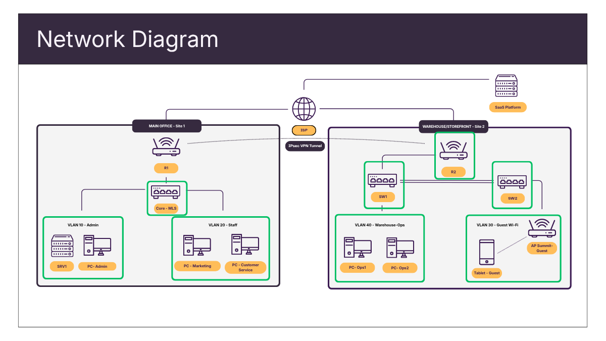

**1.** Core-MLS `show vlan brief` — Fa0/1–2 in VLAN 10, Fa0/3–4 in VLAN 20

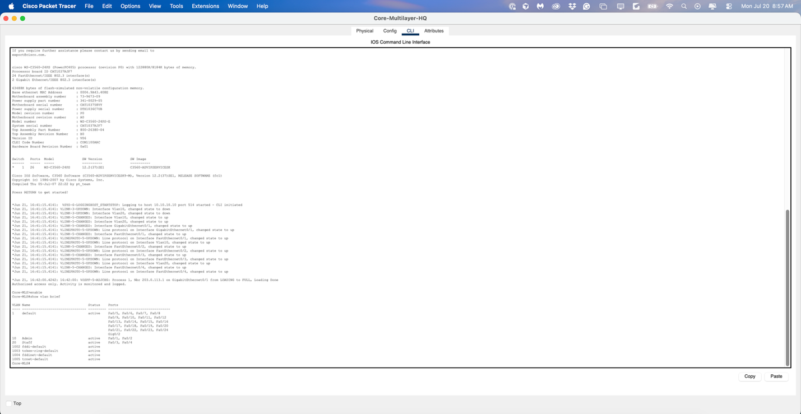

**2.** SW2 `show vlan brief` — Fa0/1 (AP link) in VLAN 30

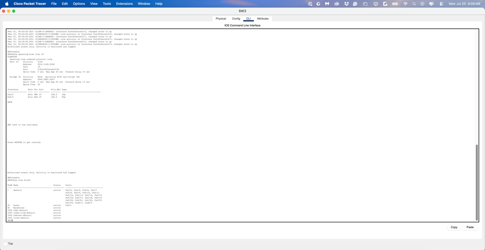

**3.** SW1 `show interfaces trunk` — Gig0/1, Fa0/2, Fa0/3 trunking 802.1q, carrying VLANs 30 and 40

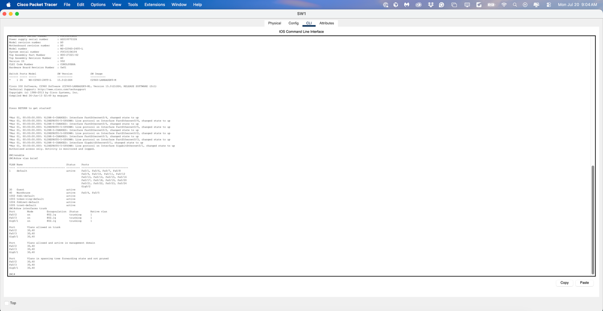

</details>


### Restricting staff access — Test Case 1

`STAFF-RESTRICT` is applied to the Staff segment on Core-MLS. It blocks Staff from
reaching Warehouse-Ops while still permitting access to SRV1. PC-Admin sits on a
segment the ACL does not filter, and serves as the control.

Three pings prove the policy in both directions:

| From | To | Expected | Observed |
| --- | --- | --- | --- |
| PC-Customer Service (VLAN 20) | SRV1 10.10.10.10 | Allowed | 4 replies, 0% loss |
| PC-Admin (VLAN 10) | PC-Ops1 10.20.40.51 | Allowed | Success |
| PC-Customer Service (VLAN 20) | PC-Ops1 10.20.40.51 | Denied | Destination host unreachable |

**Verified with** `show access-lists` on Core-MLS — the deny entry shows 4 matched
packets, confirming the ACL dropped them rather than the traffic failing for some
other reason.

> ⚠️ **Testing what is denied matters as much as testing what is allowed.** A ping
> that fails proves nothing on its own — it could be a routing problem, a wrong
> address, or a downed interface. The ACL hit counter is what turns a failed ping
> into evidence that the policy worked.

<details>
<summary><b>Evidence — Test Case 1 (5 screenshots)</b></summary>

**1.** Core-MLS `show running-config | begin Vlan20` — STAFF-RESTRICT applied to the Staff SVI

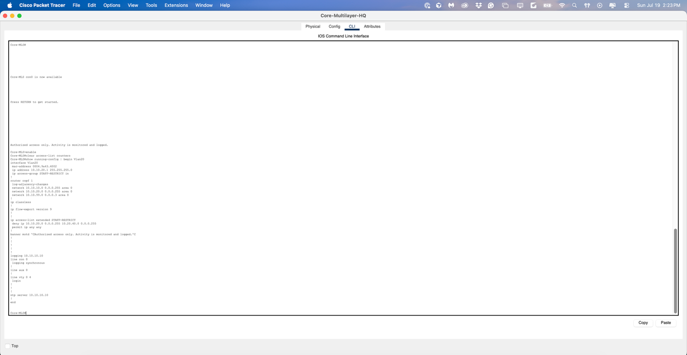

**2.** PC-Customer Service → SRV1 (10.10.10.10): 4 replies, 0% loss

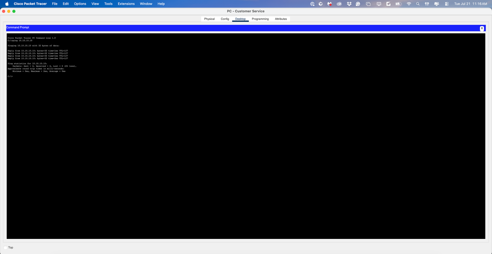

**3.** PC-Admin → PC-Ops1 (10.20.40.51): allowed

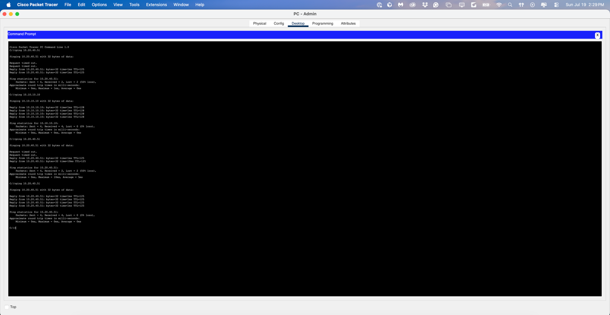

**4.** PC-Customer Service → PC-Ops1: Destination host unreachable

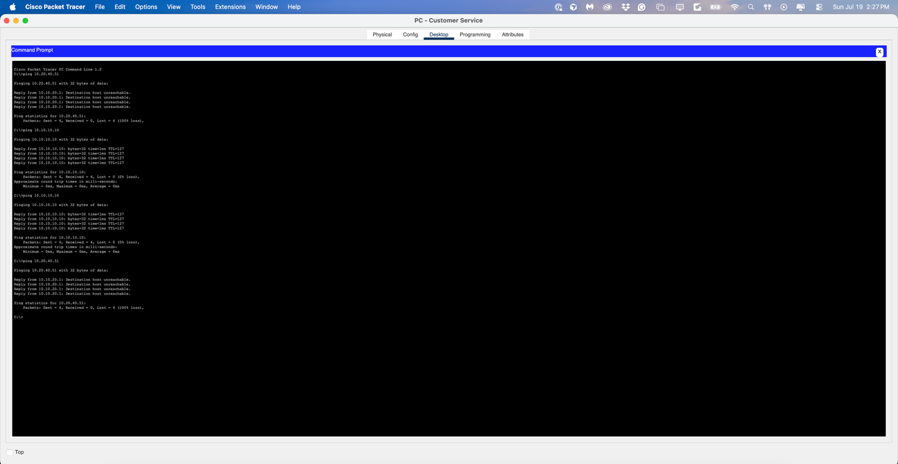

**5.** Core-MLS `show access-lists` — STAFF-RESTRICT deny entry shows 4 matches

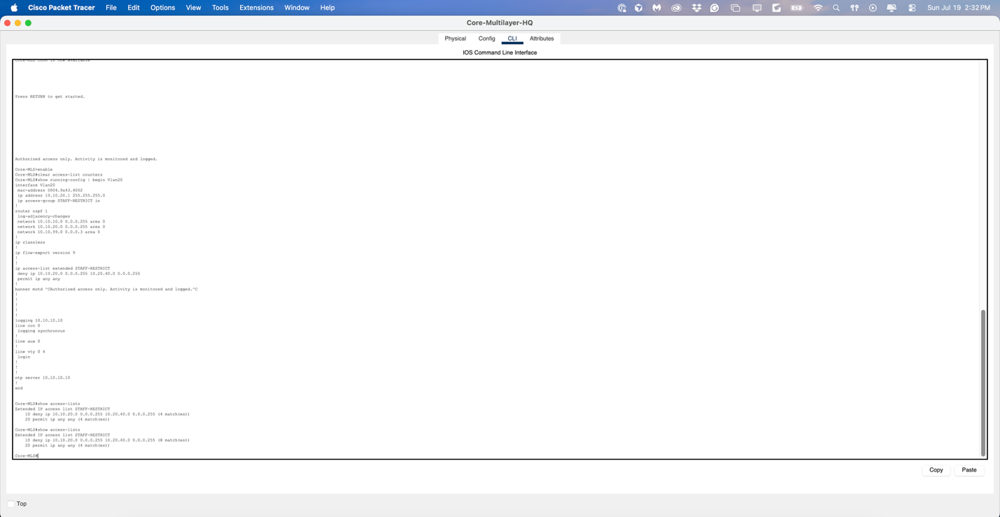

</details>


### Guest isolation — Test Case 2

The `GUEST` ACL on R2's guest subinterface permits DHCP, denies 10.0.0.0/8, and
permits everything else. Guests reach the internet; they reach nothing internal.

**Verified with** a browser on Tablet-Guest loading the SaaS host at
209.165.200.226, then a ping to SRV1 failing with a reply from the guest gateway at
10.20.30.1 — the gateway itself rejecting the traffic.

<details>
<summary><b>Evidence — Test Case 2 (4 screenshots)</b></summary>

**Devices involved in this test**

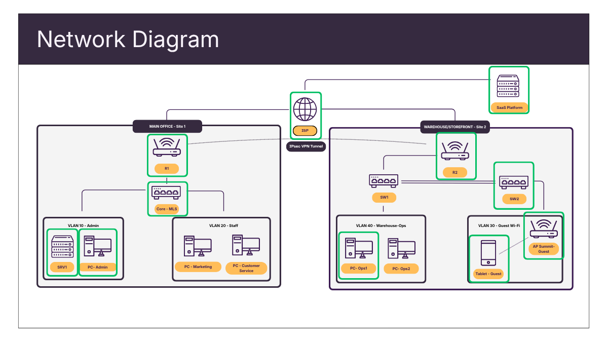

**1.** R2 — GUEST ACL applied inbound on the guest subinterface (Gig0/1.30)

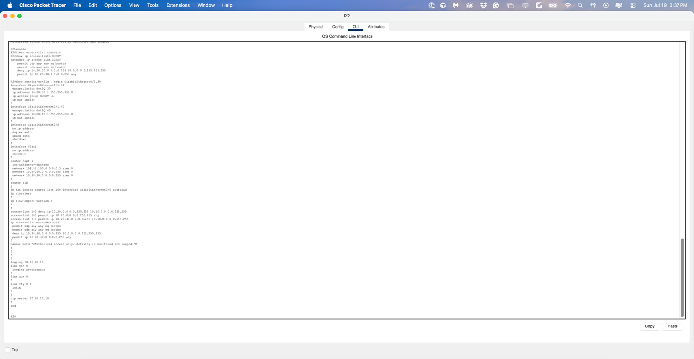

**2.** Tablet-Guest browser loads the SaaS host at 209.165.200.226

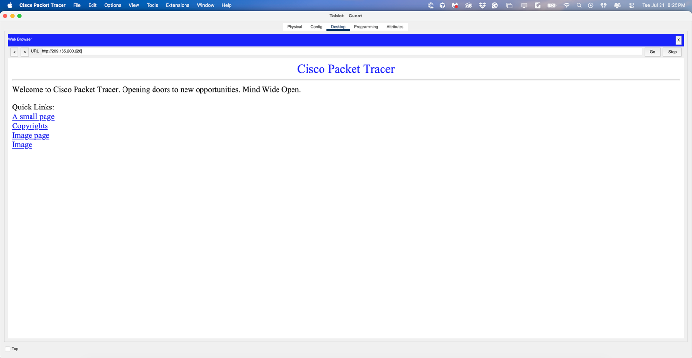

**3.** Tablet-Guest → SRV1 fails, rejected by the guest gateway 10.20.30.1

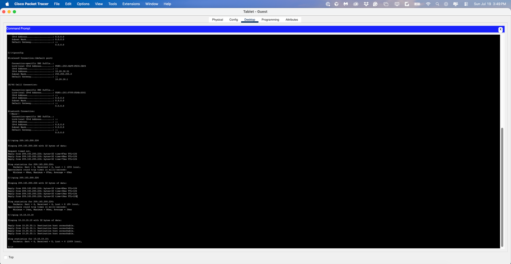

**4.** PC-Admin → SRV1 succeeds (control)

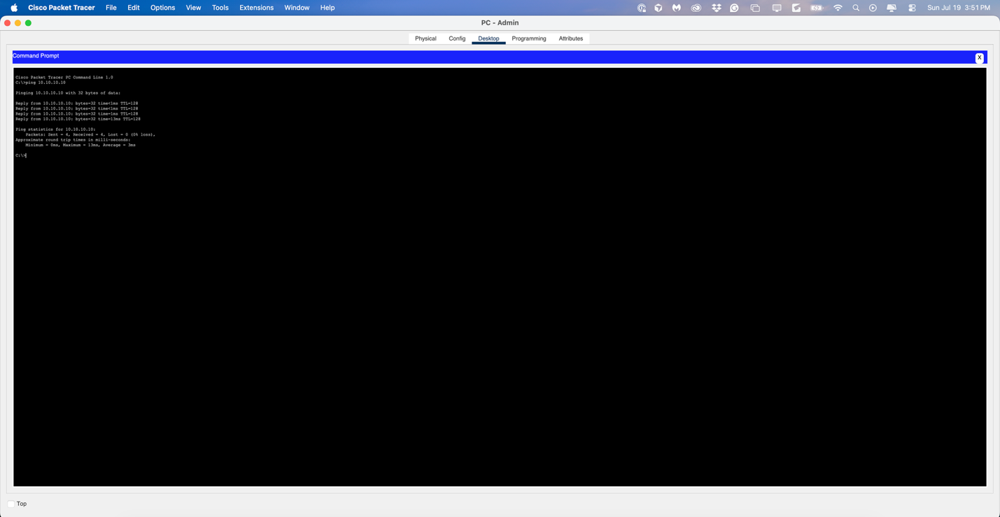

</details>


### Log-in banners — Test Case 3

An acceptable use policy banner is configured on all five managed routers and
switches, displayed before login, identifying the system as Summit Sporting Goods
property and restricted to authorized use.

**Verified with** `show running-config | begin banner`, then logging out and
reconnecting to see the banner render above the login prompt.

<details>
<summary><b>Evidence — Test Case 3 (2 screenshots)</b></summary>

**Devices involved in this test**

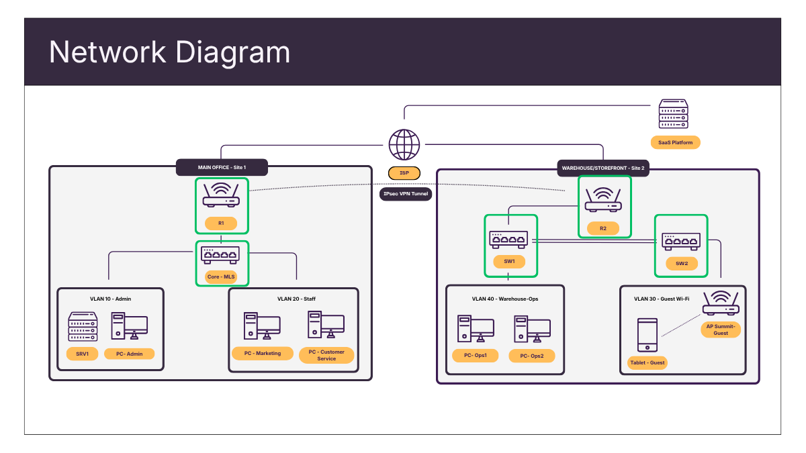

**1.** R1 `show running-config | begin banner` and the banner at login

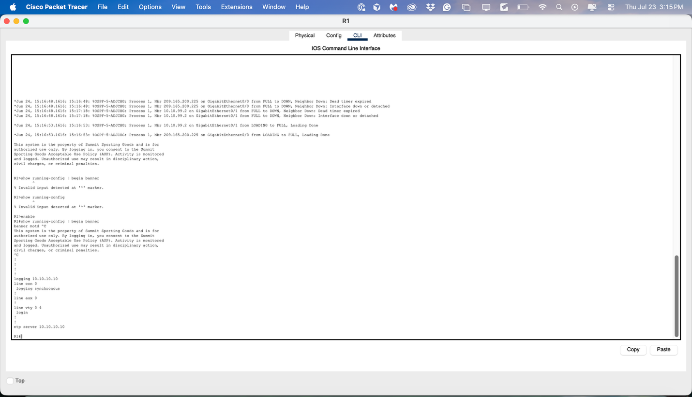

**2.** Banner displayed above the login prompt on Core-MLS

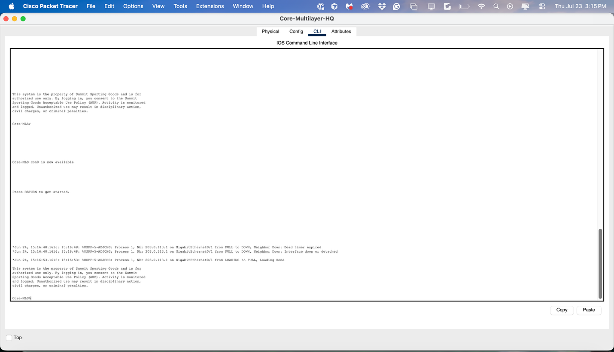

</details>


---

## Addressing Services

### DHCP and static reservation — Test Case 4

| Scope | DHCP server |
| --- | --- |
| VLAN 10 Admin, VLAN 20 Staff | Core-MLS |
| VLAN 30 Guest, VLAN 40 Warehouse-Ops | R2 |

SRV1 needs a fixed address because it provides file, Syslog, and NTP services that
other devices point at by IP. It is set statically to 10.10.10.10 **and** excluded
from the VLAN 10 pool with `ip dhcp excluded-address`, so DHCP can never hand that
address to another device.

**Verified with** `show ip dhcp binding` listing issued leases, and
`show running-config | begin dhcp` showing the exclusion.

> ⚠️ **A static address on the host is only half the job.** Without the exclusion on
> the DHCP server, the pool can still lease that address to another device and cause
> a conflict. Both sides have to agree.

<details>
<summary><b>Evidence — Test Case 4 (4 screenshots)</b></summary>

**Devices involved in this test**

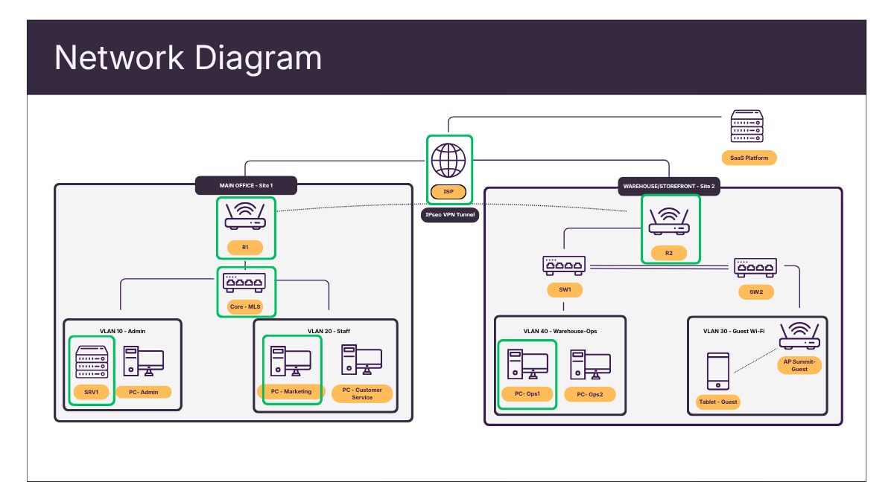

**1.** PC-Marketing set to DHCP, leased from the 10.10.20.0/24 pool

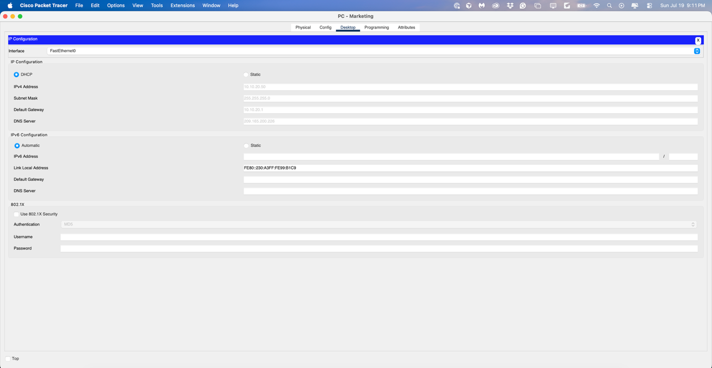

**2.** Core-MLS `show ip dhcp binding` — leases issued to Main Office workstations

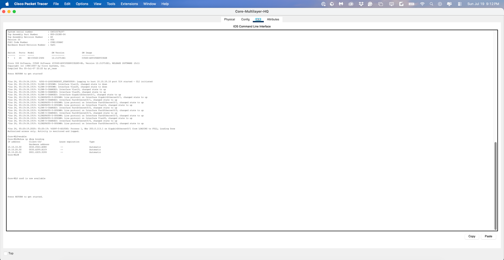

**3.** SRV1 set statically to 10.10.10.10 / 255.255.255.0, gateway 10.10.10.1

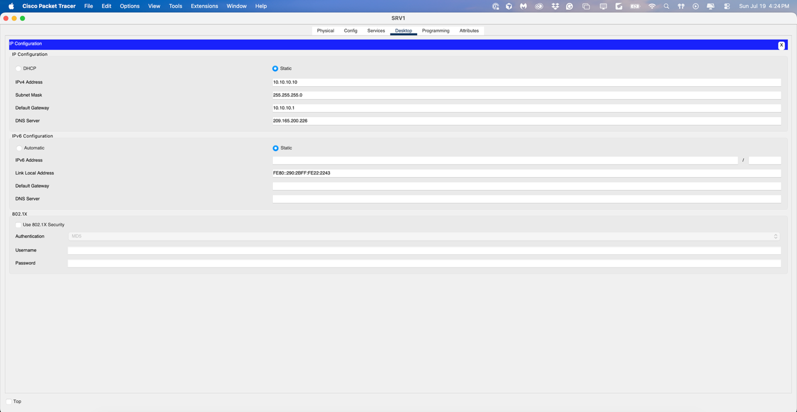

**4.** Core-MLS `show running-config | begin dhcp` — `ip dhcp excluded-address 10.10.10.10`

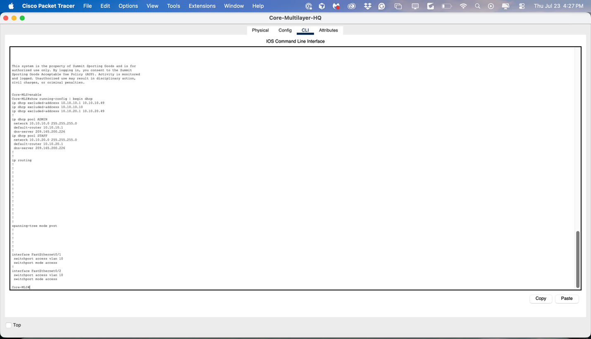

</details>


---

## Layer 2 Redundancy

### Spanning Tree — Test Case 5

SW1 and SW2 are connected by two links, Fa0/2 and Fa0/3, so the warehouse survives a
single cable or port failure. Rapid-PVST (802.1w) prevents the resulting loop from
becoming a broadcast storm while keeping the second link on standby.

Root bridge is chosen deliberately rather than left to default MAC-address
tiebreaking: SW1 set to priority 4096, SW2 to 8192.

| Switch | Configured priority | Displayed (VLAN 40) | Role |
| --- | --- | --- | --- |
| SW1 | 4096 | 4136 | Root bridge |
| SW2 | 8192 | 8232 | Secondary |

On SW2, Fa0/2 is the root port in `FWD` state and Fa0/3 is the alternate in `BLK`.

**Verified with** `show spanning-tree vlan 40` on both switches — protocol reported
as `rstp`, SW2 showing SW1's Root ID, and the port roles in the interface list.

<details>
<summary><b>Evidence — Test Case 5 (2 screenshots)</b></summary>

**Devices involved in this test**

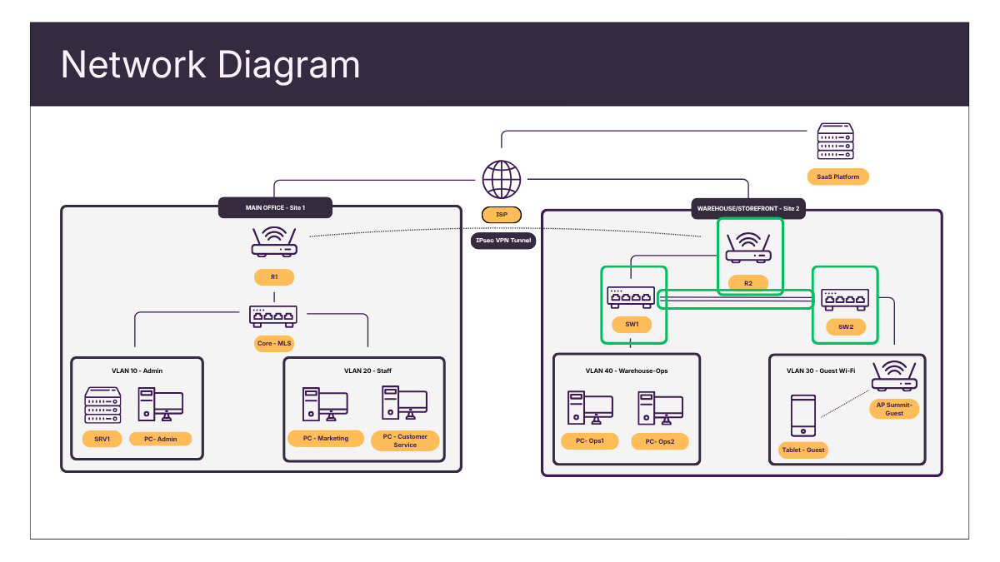

**1.** SW1 `show spanning-tree vlan 40` — rstp, SW1 is the root bridge

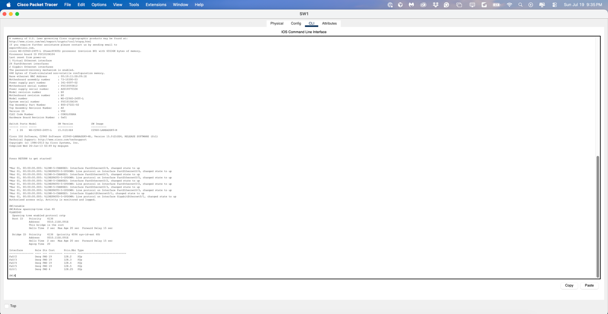

**2.** SW2 `show spanning-tree vlan 40` — Fa0/2 root port (FWD), Fa0/3 alternate (BLK)

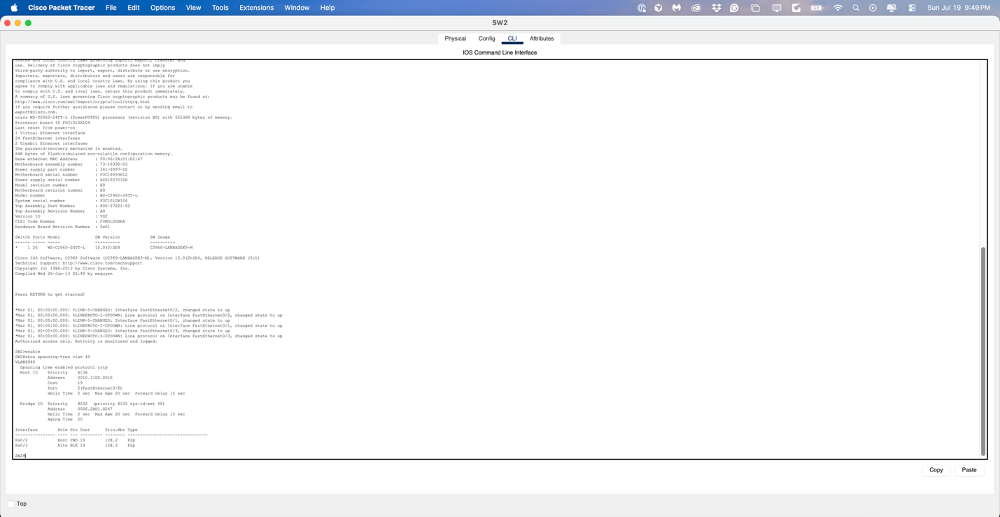

</details>


---

## Inter-Site Connectivity

### OSPF — Test Case 8

R1, ISP, R2, and Core-MLS all run OSPF, so each site learns the other's networks
without a single static route.

**Verified with** `show ip ospf neighbor` on R1 showing neighbors in `FULL` state,
then `show ip route ospf` on both edge routers:

- R1 holds 10.20.40.0 and 10.20.30.0 with the `O` code
- R2 holds 10.10.10.0 and 10.10.20.0 with the `O` code

<details>
<summary><b>Evidence — Test Case 8 (2 screenshots)</b></summary>

**Devices involved in this test**

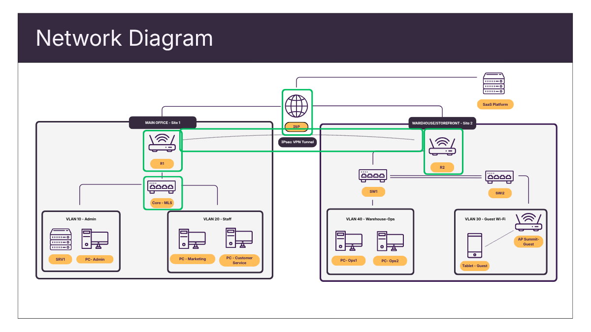

**1.** R1 `show ip ospf neighbor` — neighbors in FULL state

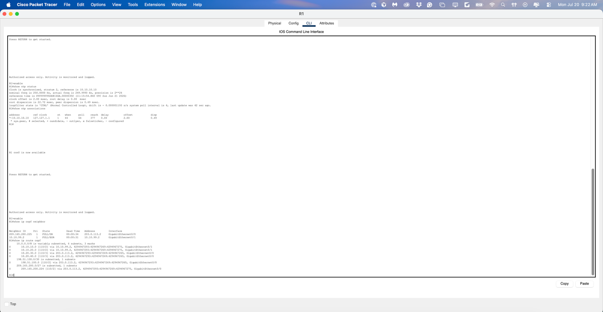

**2.** R2 `show ip route ospf` — 10.10.10.0 and 10.10.20.0 learned with the O code

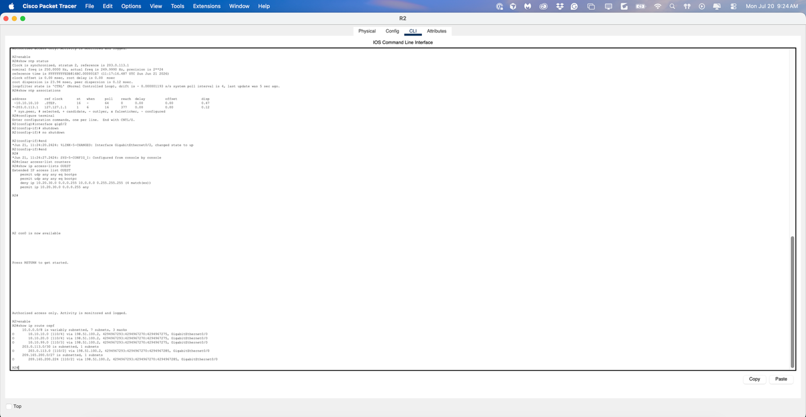

</details>


### IPSec site-to-site VPN — Test Case 9

A tunnel between R1 and R2 encrypts inter-site traffic across the internet, built
from an ISAKMP policy, a pre-shared key, and a crypto map applied to each router's
outside interface.

**Tested in three stages:**

1. **Before qualifying traffic** — `show crypto isakmp sa` returns an empty table and
   `show crypto ipsec sa` shows zero counters. The tunnel has not been triggered.
2. **Trigger** — ping from PC-Admin to PC-Ops1 at 10.20.40.51. The first packets
   time out while the tunnel negotiates, then replies succeed.
3. **After** — the tunnel to R2 at 198.51.100.1 appears in `QM_IDLE` / `ACTIVE`, and
   the IPSec counters show packets encrypted and decrypted in both directions.

**Guest exclusion verified with** `show access-lists 110` — the crypto ACL matches
office traffic to 10.20.40.0/24 and contains no entry for the guest subnet, so guest
traffic never enters the tunnel.

<details>
<summary><b>Evidence — Test Case 9 (4 screenshots)</b></summary>

**Devices involved in this test**

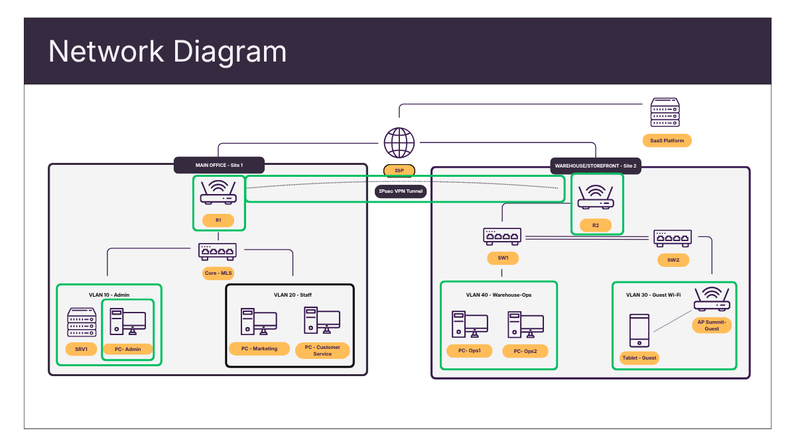

**1.** Before traffic — `show crypto isakmp sa` empty, `show crypto ipsec sa` counters at zero

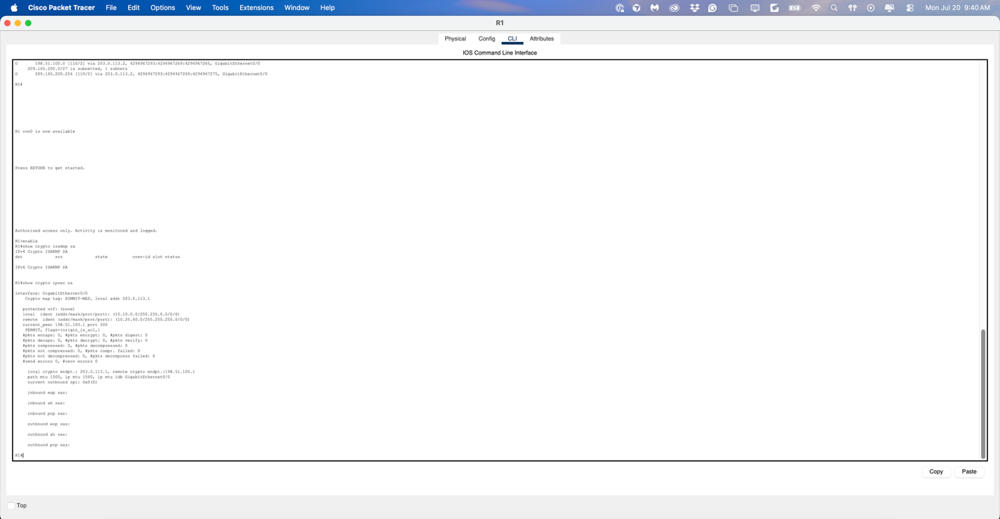

**2.** PC-Admin → PC-Ops1 triggers the tunnel; first packets time out, then replies succeed

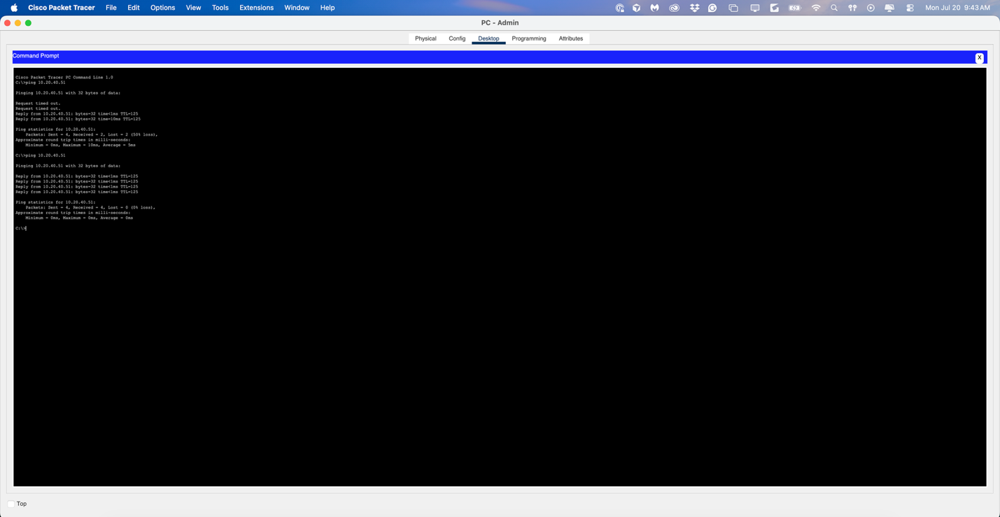

**3.** After — tunnel QM_IDLE / ACTIVE, packets encrypted and decrypted in both directions

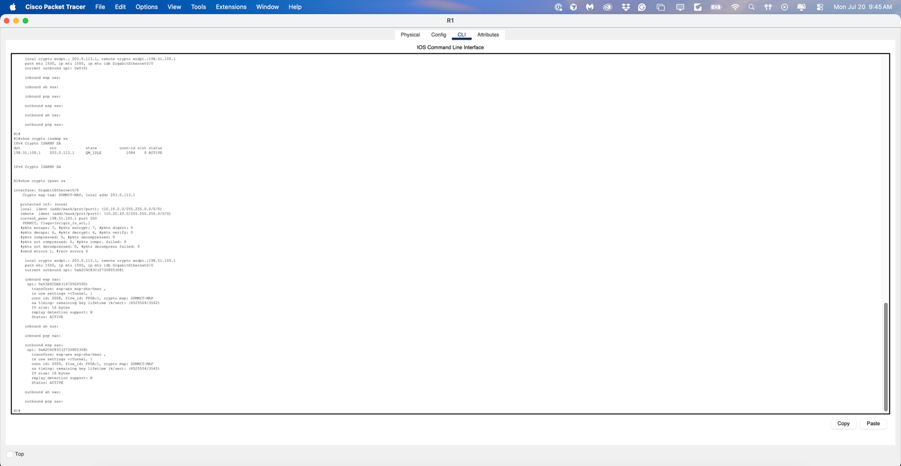

**4.** R1 `show access-lists 110` — crypto ACL matches office traffic only; no guest entry

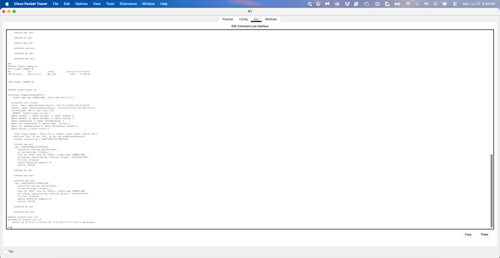

</details>


---

## Security and Monitoring

### Syslog and NTP — Test Case 6

Every device syncs its clock from SRV1 and forwards logs there, configured with
`logging 10.10.10.10` and `service timestamps log datetime msec` so each entry
carries an accurate timestamp. Without synchronized clocks, correlating events across
devices is guesswork.

**Verified with** `show ntp status` on R1 and R2 reporting a synced clock, then
bouncing an interface on R2 (`shutdown` / `no shutdown`) and watching the event
arrive in SRV1's Syslog service with a timestamp.

**Platform limitation, stated plainly:** Packet Tracer rejects the `log` keyword on
access list entries, so denied packets cannot be forwarded to the Syslog server the
way they would be on production hardware.

*On production hardware* I would add logging to each deny entry so a denied packet
generates a syslog message carrying its source, and feed those logs into a SIEM
alerting on patterns like repeated denies from one host.

*In this environment* unwanted traffic detection was demonstrated with the tools the
platform does support: clearing the ACL counters, generating a denied ping from
Tablet-Guest to SRV1, confirming the deny counter incremented, then tracing the same
packet in simulation mode and watching the PDU dropped at R2 with the access list
named as the cause.

<details>
<summary><b>Evidence — Test Case 6 (7 screenshots)</b></summary>

**Devices involved in this test**

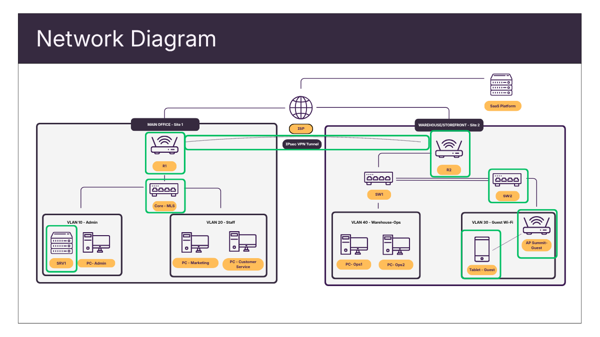

**1.** SRV1 NTP service on, date and time set

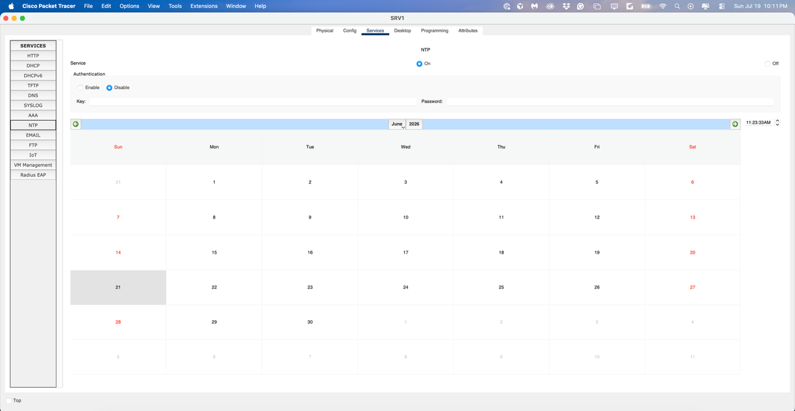

**2.** R1 `show ntp status` — clock synced to SRV1 (10.10.10.10)

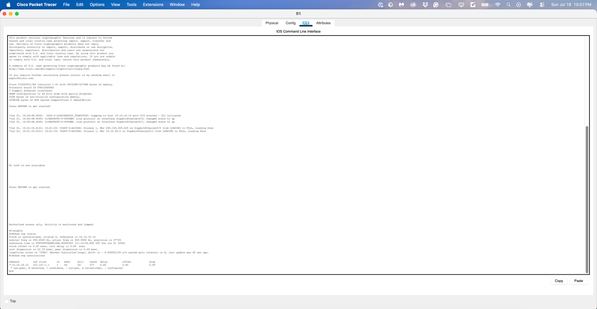

**3.** R2 `show ntp status` — clock synced

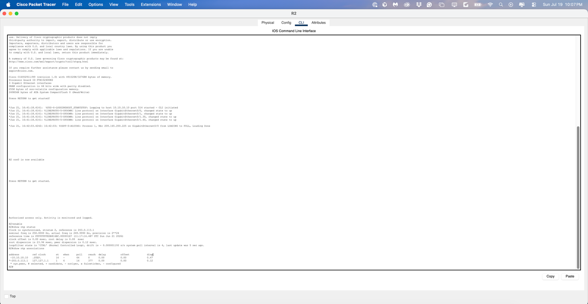

**4.** SRV1 Syslog service on

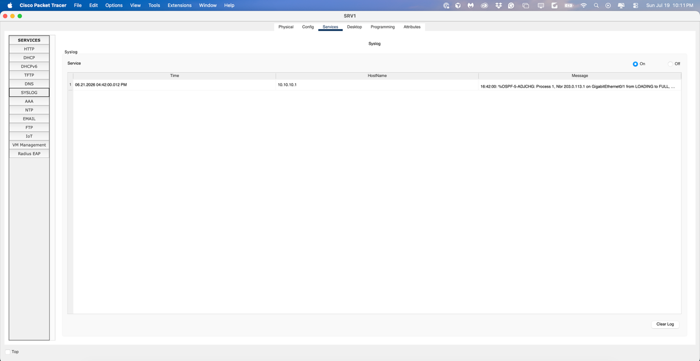

**5.** Interface bounce on R2 arrives in SRV1 Syslog with a timestamp

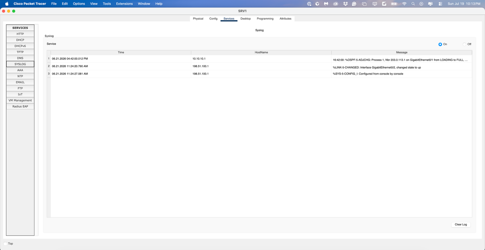

**6.** R2 `show ip access-lists GUEST` — deny counter incremented after a denied guest ping

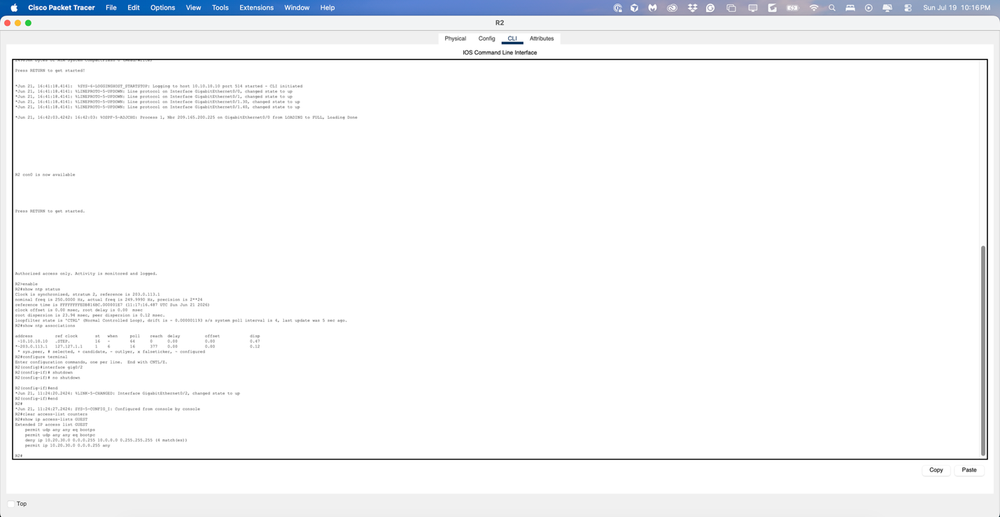

**7.** Simulation mode — guest PDU to SRV1 dropped at R2, access list named as the cause

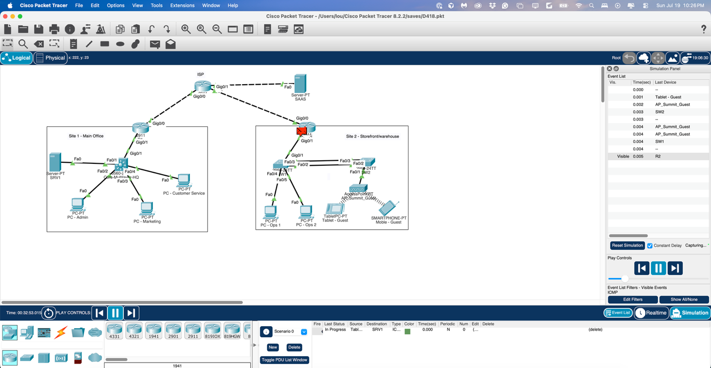

</details>


### Port security — Test Case 10

The Warehouse-Ops access ports on SW1 (Fa0/4 and Fa0/5, VLAN 40) are physically
reachable on a warehouse floor, so each is configured with sticky MAC learning, a
maximum of one MAC address, and shutdown on violation.

**Tested by** disconnecting PC-Ops1 from Fa0/4 and connecting Laptop-Rogue to the
same port, then generating traffic from it.

**Result:** the ping timed out because the port had been disabled.
`show port-security interface fa0/4` reported Port Status `Secure-shutdown` with the
last source address matching Laptop-Rogue (00E0.F9C5.A8BB) — the violation logged
with the offending MAC.

<details>
<summary><b>Evidence — Test Case 10 (3 screenshots)</b></summary>

**Devices involved in this test**

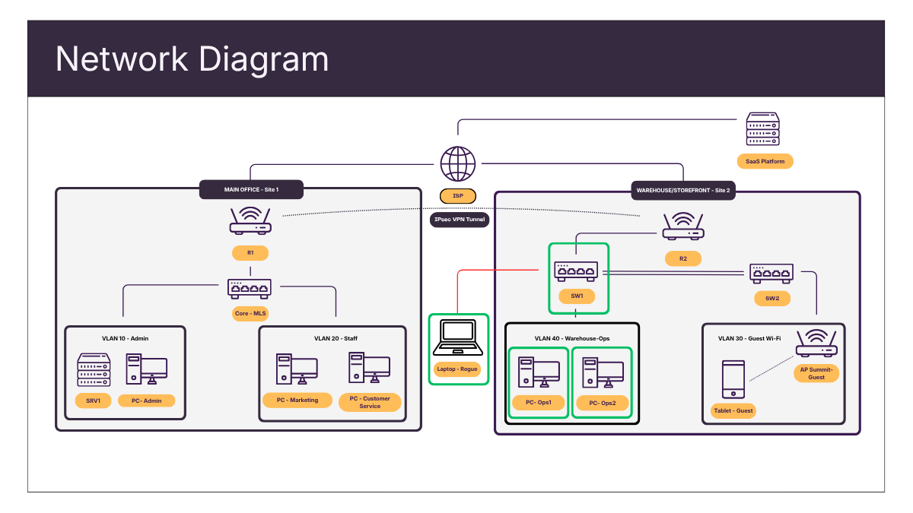

**1.** SW1 port security — sticky MAC, maximum 1, shutdown on violation; authorized MACs learned

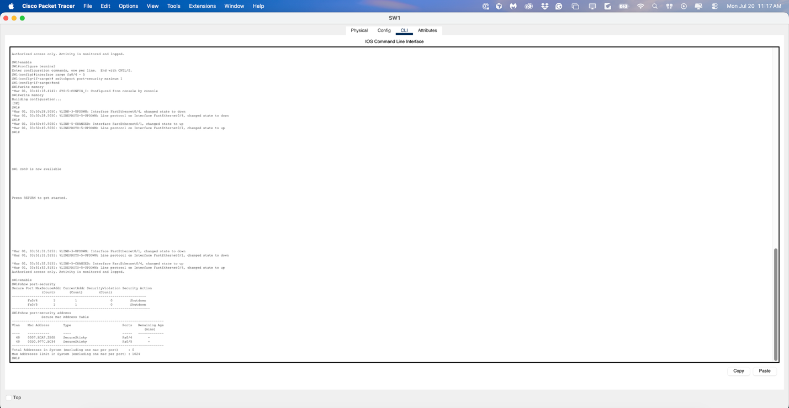

**2.** Laptop-Rogue connected to SW1 Fa0/4 in place of PC-Ops1

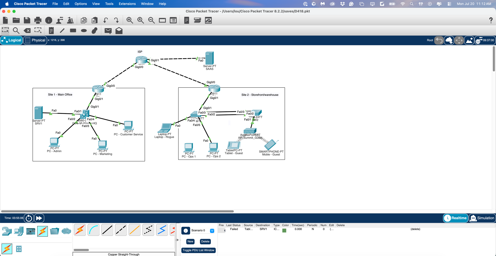

**3.** SW1 `show port-security interface fa0/4` — Secure-shutdown, last source MAC = Laptop-Rogue (00E0.F9C5.A8BB)

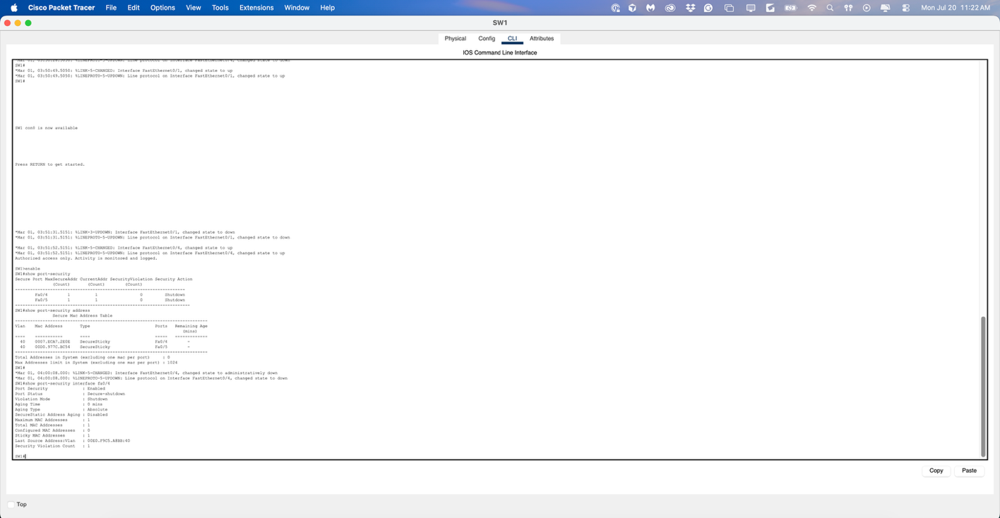

</details>


---

## Problems Resolved

Method: `ping` to test reachability, `show` commands to inspect device state, and
simulation mode to trace where traffic stopped. When a test case failed, the problem
was isolated before anything was changed.

### Warehouse workstations fell back to APIPA addresses

**Symptom** — PC-Ops1 and PC-Ops2 self-assigned 169.254.x.x addresses instead of
leasing from DHCP.

**Investigation** — ran `show ip dhcp pool` on R2 first and saw a healthy pool, which
ruled out the server. Moved down to Layer 2 and ran `show vlan brief` on SW1.

**Root cause** — Gig0/1, the uplink from SW1 to R2, was sitting on VLAN 1 as an
access port. VLAN 40 traffic could not reach R2, so the DHCP Discover never arrived.

**Resolution** — configured Gig0/1 as an 802.1Q trunk carrying VLANs 30 and 40. Both
workstations leased addresses immediately.

**What it demonstrates** — an APIPA address is never the problem, it is the visible
result of Discover or Offer failing. Checking the server first and finding it healthy
is what pointed at the path rather than the service.

### Guest ACL silently blocked DHCP

**Symptom** — after the trunk fix, the guest tablet still could not lease an address.

**Investigation** — worked the path one hop at a time and ruled each piece out.
With everything else checking out, suspicion fell on the GUEST ACL. Removing it
confirmed the theory instantly — the tablet pulled 10.20.30.50.

**Root cause** — a DHCP Discover is sourced from 0.0.0.0, because the client has no
address yet. That source never matched the ACL's permit entries, so it fell through
to the deny.

**Resolution** — added `bootps` and `bootpc` permits above the deny statement. Guests
can now receive DHCP addresses while still being blocked from internal networks.

**What it demonstrates** — an ACL written around the addressed steady state can break
the unaddressed bootstrap that has to happen first.

### Crypto commands rejected on the edge routers

**Symptom** — `crypto isakmp policy` returned an input error on R1 and R2 during
Test Case 9 setup.

**Investigation** — ran `show version`.

**Root cause** — the security technology package required for crypto commands was
disabled on both routers.

**Resolution** — enabled the security license, saved, and reloaded each router. The
crypto command set became available.

**What it demonstrates** — an unrecognized command is not always a syntax error.
Feature licensing gates entire command sets, and `show version` answers that question
in one step.

---

## Lessons Learned

**Test the denials, not just the permissions.** Half of an access policy is what
cannot happen. A failed ping alone proves nothing — the ACL hit counter is what makes
it evidence.

**Work bottom-up when addressing fails.** Both DHCP failures looked like server
problems and neither was. Confirming the server is healthy is what redirects
attention to the path.

**A protocol's setup phase has different rules than its steady state.** DHCP from
0.0.0.0 and an IPSec tunnel that only builds on qualifying traffic are the same
lesson twice: the first packet does not look like the ones that follow.

**State the platform's limits rather than working around them quietly.** Packet
Tracer cannot log ACL denials. Documenting that, explaining the production approach,
and demonstrating the closest equivalent is more honest than presenting a partial
result as complete.

---

## Tools & Technologies

| Tool | Purpose |
| --- | --- |
| Cisco Packet Tracer | Virtual lab environment for the full topology |
| OSPF | Dynamic routing between sites |
| IPSec / ISAKMP | Site-to-site VPN encryption |
| 802.1Q | VLAN trunking between switches |
| Rapid-PVST (802.1w) | Layer 2 loop prevention with redundant links |
| Extended ACLs | Segment access control and guest isolation |
| DHCP | Dynamic addressing with static reservation |
| Port security | Physical access port protection |
| NTP / Syslog | Clock synchronization and centralized logging |
| Simulation mode | Packet-level tracing for verification |

---

## Project Status

- ✅ Two-site topology built, four VLANs segmented
- ✅ OSPF adjacencies formed, routes exchanged both directions
- ✅ Site-to-site IPSec tunnel active, guest traffic excluded
- ✅ Access control enforced and verified with hit counters
- ✅ Spanning Tree root bridge set deliberately, alternate port blocking
- ✅ Port security violation triggered and logged
- ✅ NTP synced, Syslog receiving timestamped events
- ✅ All ten test cases run and evidenced
- ✅ Topology diagram, legend, and evidence screenshots added to the repo
- ⬜ Video walkthrough recorded
- ⬜ Device configurations exported to `/configs`
- ⬜ Failover test — pull the active warehouse link and confirm STP converges

---

*Built as a portfolio project demonstrating multi-site network design, dynamic
routing, VPN encryption, Layer 2 segmentation and redundancy, access control,
and structured verification against defined test cases.*
